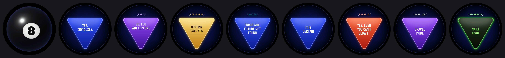
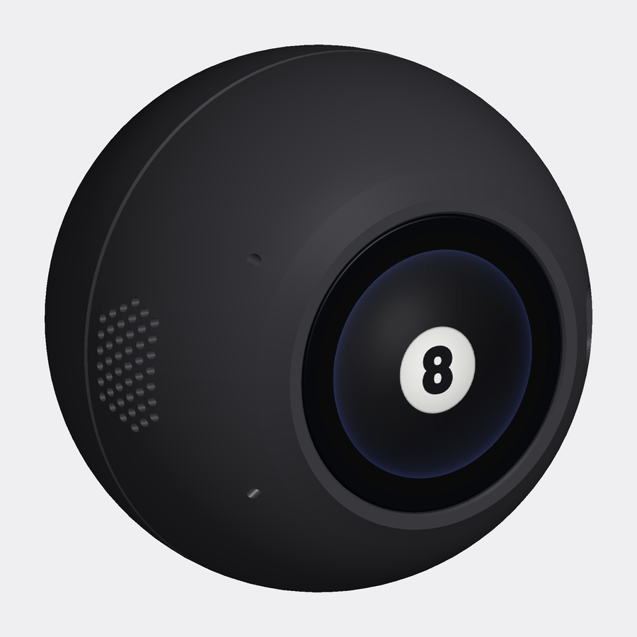
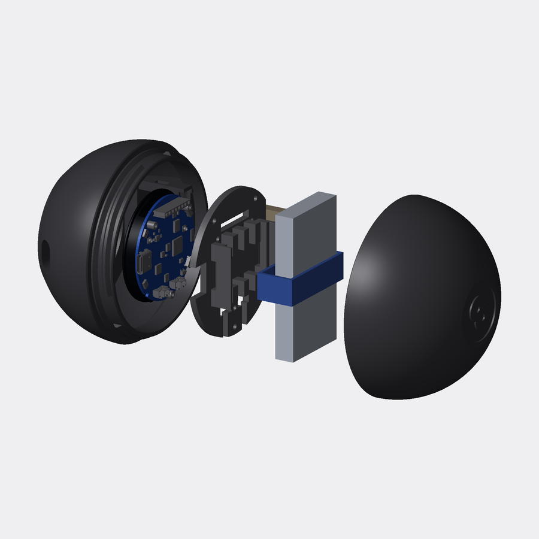

# Magic 8 Ball

A Magic 8 Ball that feels like a gadget, not a toy: ESPHome firmware for the **Waveshare
ESP32-S3-Touch-AMOLED-1.75** (466 × 466 round AMOLED) plus a 3D-printed 88 mm ball to put it in.

Shake it and the ball turns over to its liquid window. A 20-sided die tumbles in the murk,
rises to the glass, and its face becomes the answer. It has three answer modes, loot-style
rarity tiers and easter eggs. There are also secret gestures for whoever's holding it,
original synthesized sounds, and battery management with deep sleep and wake-on-pickup.
Everything runs on the board; no cloud, no app.



<p align="center"> </p>

## Features

**How it plays**
- **Idle:** a glossy black 8-ball. The white "8" rolls and sloshes when you move it.
- **Ask:** ask a question, then **shake it**. You can also hold it **face down for 1–6 s and turn it over**, or **tap** the screen.
- **Reveal:** the ball turns over to its liquid window and a 20-sided die tumbles in the murk. It rises to the glass and its face becomes the answer, with a flash of light as it lands.
- **Afterwards:** the answer floats there for 20 s, then the ball comes back. It dims after 45 s without movement and goes dark after 2.5 min; any movement wakes it. Face down = dark.

**Modes**: **double-tap the screen** to switch. The ball flips and the new mode's card surfaces (MODE 1/3, 2/3, 3/3). The mode is remembered, and its name shows briefly whenever the ball wakes.

| Mode | Answers | Look and sound |
|---|---|---|
| 1 · **Oracle** | 84 original lines with rarity tiers, plus 9 easter-egg variants (below) | blue / purple / gold / glitch triangles |
| 2 · **Classic** | the traditional 20, equally likely, no tiers or eggs | blue triangle, glass chime |
| 3 · **Roast** | 34 cheeky lines that still answer: they tease the *question*, never the kid. Has its own eggs | red triangle, red "8" disc on the idle ball, ROASTED tag, ba-dum-tss |

A single tap waits about 0.4 s before asking, to tell it apart from a double tap.

**Secret swipes (for whoever's holding it):** a quick one-finger swipe across the screen rigs the *next* answer, which still needs the usual shake, tap or flip.

| Swipe | Next answer |
|---|---|
| **Up** | **SKILL ISSUE**, in any mode: its own tier, with a black glass triangle, neon-green rim and text, a DIAGNOSIS tag, a thud as it lands, and a sad trombone |
| **Left** | a **yes** from the current mode (in Oracle it keeps the usual odds, so it can land as a rare or legendary yes) |
| **Right** | a **no** from the current mode |
| **Down** | in **Roast** mode: the **video prank**. The next shake plays a short clip with sound from the SD card, then a "YOU GOT RICKROLLED" card with a rimshot. A tap skips the clip. In other modes: cancels a rig. *No clip is included; see [Your own clip](#your-own-clip)* |

There's no visible signal: the "8" just sloshes in the swipe direction (or the answer on screen nudges), the way it would if you'd jostled the ball. A rig lasts for one answer. The swipe-up answer is the only SKILL ISSUE in the set; the old rare one became "GIT GUD".

**Sound** (a small speaker on the board's SPK connector)
- **Asking:** the ball flips over with a whoosh, the liquid churns with bubbles (they keep coming while he keeps shaking), and the die surfaces with a rising shimmer.
- **Landing**, on the flash of light, depends on rarity: glass chime for common, sparkle duet for RARE, rising fanfare with a sparkle shower for LEGENDARY, bit-crushed stutter for GLITCH, and a playful "wah-wah" for SECRET.
- **Smaller cues:** a soft whoosh as the answer sinks, a two-note chime on wake, a "power up" blip when plugged in, and a falling two-tone at 15% and 5% battery.
- **Long-press the screen (1.2 s)** to turn sound off or on; it's remembered. Volume is 75%, dropping to 35% from 22:00 to 07:00.
- All sounds are original, synthesized by `tools/make_sounds.py` (no samples).

**Battery** (a 1S LiPo, e.g. an LP103665 3.7 V 3000 mAh, on the board's battery connector)
- **Charging** is handled by the board's AXP2101: 4.2 V at 500 mA, so roughly 6–7 h from empty. That's gentle on the cell and on heat inside a closed shell. It charges from USB whether the ball is awake or not.
- **On the idle ball, plugged in:** a green **CHARGING 64%** pill gently pulses, then shows **CHARGED**. Plugging in wakes the screen with a small flash.
- **On the idle ball, on battery:** an amber **LOW BATTERY** pill appears at ≤15%, turning red and pulsing at ≤5%. Unplugging shows the percentage for 5 s.
- **Deep sleep (battery only):** after the 2.5-min dark timeout, or 60 s face down, it sleeps almost completely. **Picking it up wakes it** (the IMU's wake-on-motion), within a couple of seconds. Plugged in it never deep-sleeps, so it stays reachable for updates over Wi-Fi.
- **Empty:** at ≤2% or below 3.35 V (three readings in a row) it shows **BATTERY EMPTY** and switches the whole board off, so the cell is never run flat. USB or the PWR button turns it back on.
- **Home Assistant:** if you add the device to HA, it reports Battery %, Battery voltage and Charging.

**Oracle rarity** (rolled per ask, no repeats among the last 10):

| Tier | Chance | Look |
|---|---|---|
| Common | 78% | blue triangle |
| Rare | 16% | purple triangle, RARE tag |
| Glitch | 3% | blue, jitters and flickers, GLITCH tag |
| Legendary | 3% | gold triangle, sparkles, bigger flash, LEGENDARY tag. Guaranteed within 40 asks |
| Secret | eggs | **shake really hard** (above 4.5 g, 30% chance) → "WHOA! EASY THERE" and 3 other variants; **3 asks in 25 s** (35%) → "PATIENCE, YOUNG ONE" and others; **22:00–06:00** (25%) → "GO TO SLEEP." and others. Roast mode has its own versions |

Each egg has a 15-ask cooldown and rotates its variants. Before this, a normal hard shake (a kid easily passes 3.4 g) fired "WHOA" 60% of the time.


## Hardware

| Part | Notes |
|---|---|
| **Waveshare ESP32-S3-Touch-AMOLED-1.75** | The bare board, not the "-B" version in Waveshare's own case |
| 1S LiPo, 35 × 65 × 9 mm (e.g. LP103665, 3000 mAh), MX1.25 2-pin plug | ⚠️ Check that red goes to **+** on the board's BAT connector: sellers wire these plugs both ways |
| 20 × 30 × 5 mm enclosed box speaker, MX1.25 2-pin plug | Goes on the SPK connector |
| microSD card | Optional: only for the video prank. FAT32 (the firmware can format it) |
| The printed case, 3 × M2×6 + 3 × M2×8 screws, a 12 mm hook-and-loop strap | See [case/README.md](case/README.md) for parts, printing and assembly |

## Build and flash

You need [ESPHome](https://esphome.io) (built with **2026.8.2**) and Python 3. The first build
downloads ESP-IDF components, so it needs internet and takes a while.

```bash
git clone https://github.com/rcostache230/magic-8-ball.git
cd magic-8-ball
cp secrets.yaml.example secrets.yaml      # then fill in your Wi-Fi, an API key and an OTA password
esphome run magic-8-ball.yaml             # first time over USB; pick the board's serial port
```

After that, updates go over Wi-Fi: `esphome run magic-8-ball.yaml --device magic-8-ball.local`.
Set your time zone with the `timezone` substitution at the top of `magic-8-ball.yaml`; the
late-night volume and the bedtime easter egg use it.

The generated files (`answers_gen.h`, `assets_gen.h`, `die_frames.yaml`, `assets/`, `sounds/`)
are committed, so you don't need to run the generators to build. Change something, and:

```bash
python3 tools/make_assets.py     # after editing answers.txt or the art (needs Pillow and numpy)
python3 tools/make_sounds.py     # after changing a sound (needs numpy)
```

## Make the answers yours

All the answers live in [`answers.txt`](answers.txt), one per line: `kind [mood] | line 1 | line 2 | line 3`.
The kind picks the mode and tier (`common`, `rare`, `legendary`, `glitch`, `classic`, `roast`, the
`secret:`/`roast:` easter eggs). The mood (`yes`, `no`, `maybe`) is what the left/right swipes
choose from. The answers are drawn inside a point-down triangle, so `make_assets.py` refuses
any line that doesn't fit, and writes `assets/answers_sheet.png` so you can see them all.

## Your own clip

The Roast-mode video prank plays a clip from the microSD card. **None is included**: make one
from a video you have the right to use.

```bash
python3 tools/make_video.py path/to/video.mp4 --start 42.8 --duration 12   # writes media/sd/m8/
ESPPY=$(head -1 "$(which esphome)" | sed 's/^#!//')          # ESPHome's Python has pyserial
$ESPPY tools/sdcard.py format --yes   # once, if the card isn't FAT32 (erases it)
$ESPPY tools/sdcard.py sync           # copies media/sd/ to the card over the USB cable
$ESPPY tools/sdcard.py raw RIG 4 && $ESPPY tools/sdcard.py raw ASK   # play it now
```

The card stays in the board: `sdcard.py` talks to the firmware over the USB cable, and every
copy is CRC-checked on the board. The clip is stored as 512-byte-aligned JPEG frames sized to
fit the round screen, plus a 22.05 kHz mono WAV.

## The case

An 88 mm black ball in three printed parts. The AMOLED sits flush in one face, a raised **8**
is on the other, and the back twist-locks shut with no screws showing. The speaker clicks into
a sleeve behind a side grille, and a strap holds the battery, so nothing needs glue or tape. It
prints without supports on a Bambu Lab A1 mini in about two hours. Parts list, print settings
and step-by-step assembly: [case/README.md](case/README.md).

## How it works

[docs/DEVELOPMENT.md](docs/DEVELOPMENT.md) covers the code layout, the dev tools (remote
control over Wi-Fi, SD card over USB) and what was learned bringing it up on this board.
The topics include the IMU's mounting, the performance budget for animation, wake-on-motion,
the USB driver dropping data, and FAT on a 64 GB card.

## Credits

- [ESPHome](https://esphome.io) and [LVGL](https://lvgl.io): display, touch, IMU, audio and UI.
- Espressif's [`esp_new_jpeg`](https://components.espressif.com/components/espressif/esp_new_jpeg)
  decodes the video frames. It's downloaded at build time, not included here.
- AXP2101 and QMI8658 register details were taken from Lewis He's XPowersLib and SensorLib, as
  shipped in [Waveshare's board repository](https://github.com/waveshareteam/ESP32-S3-Touch-AMOLED-1.75).
- [Barlow](https://github.com/jpt/barlow) and Barlow Condensed fonts, SIL Open Font License
  (`fonts/OFL.txt`).
- The art and sounds are original, generated by the scripts in `tools/`.

## License

- **Code** (firmware, components, tools): [MIT](LICENSE).
- **Case model, art and sounds** (`case/`, `assets/`, `sounds/`):
  [CC BY-NC-SA 4.0](LICENSE-CC-BY-NC-SA-4.0.txt). Remix freely, credit the original, share alike,
  no commercial use.
- **Fonts:** SIL Open Font License 1.1 (`fonts/OFL.txt`).
