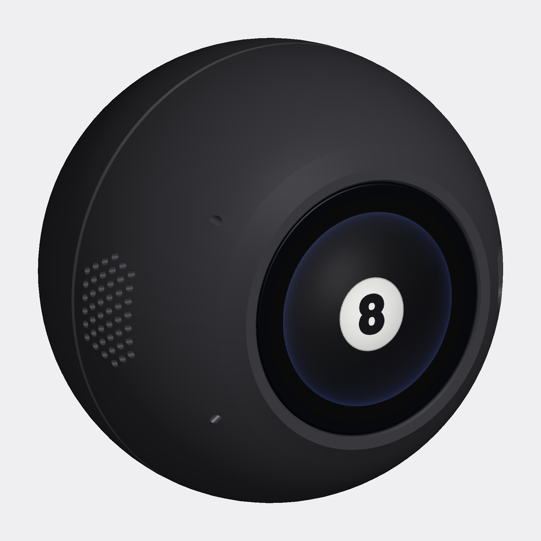
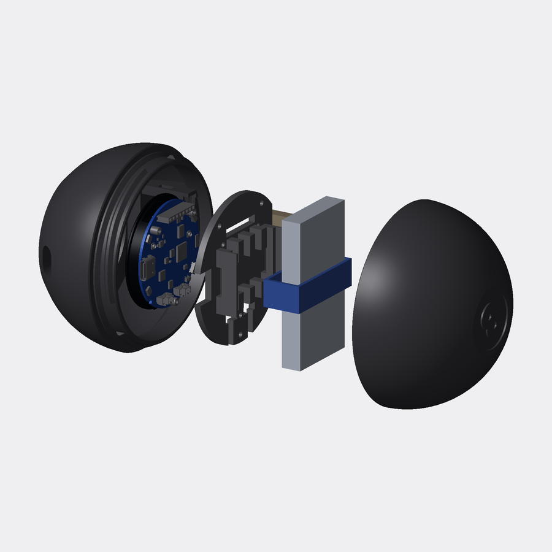
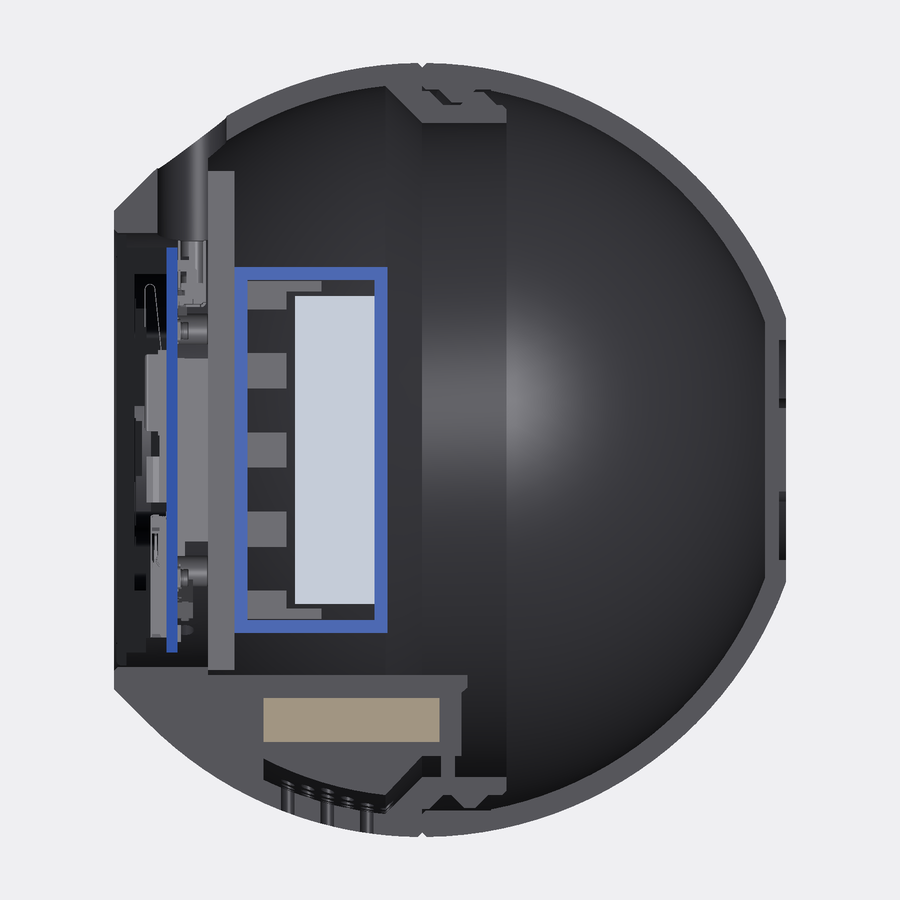

# Magic 8 Ball shell

An 88 mm ball for the Waveshare ESP32-S3-Touch-AMOLED-1.75: the bare board, not the "-B" version
that ships in Waveshare's own case. The round AMOLED sits flush in one face as the window. A
raised **8** on the opposite pole matches the firmware's own "8" (same font, Barlow Black). A
speaker grille sits on the side. No screws show from outside: the only openings are the grille,
a USB-C slot and two 2 mm pin holes for PWR and BOOT.



**Status:** printed and assembled on a Bambu Lab A1 mini. It prints cleanly, the glass fits its
bore and the twist lock closes as designed. This version adds a strapped battery cradle and a
speaker mount; those two are checked in CAD and the slicer but not printed yet (see
[What is proven](#what-is-proven-and-what-isnt-yet)).

| File | What it is |
|---|---|
| `out/magic-8-ball-case.3mf` | **Print this.** All three parts in print orientation on one A1 mini plate |
| `out/fit-test-coupons.3mf` | Thin slices of every fit (glass bore, both halves of the twist lock, the speaker sleeve) for checking a printer before the full print |
| `out/front.stl`, `out/cap.stl`, `out/carrier.stl` | The same parts as separate STLs |
| `out/assembly.step` | Assembled shell for CAD |
| `out/preview-*.png` | Renders with the board, battery, speaker and strap in place (front, face, side, speaker grille, back, exploded, cut-away) |
| `case.py` | The parametric source. Change a number at the top, run it, get new files and a new fit check |
| `tools/` | `validate_fit.py` (proves the checks can fail), `render.py` (the previews), `overhangs.py` (support check) |

## How it goes together

- **front** (the window half).
  - The glass sits in a bore with 0.2 mm clearance a side, 0.3 mm below a flat 2.5 mm bezel. It
    reads as flush, but set face-down the ball lands on the bezel, not the glass.
  - A 45° bevel joins the bezel to the sphere, which is what lets this half print window-down with
    no supports.
  - On the PWR/BOOT side, a sleeve holds the speaker face-out behind an oval grille of 45 holes.
    The speaker slides down into it and a sprung latch arm clicks over its top edge. Lips hold the
    face, and ribs on the sleeve take up the play.
- **carrier**, a plate behind the board.
  - The board's own three M2 standoffs screw onto it, and that sets the glass depth. Three more
    screws fix it to the frame behind the glass.
  - The battery sits on its back between two side walls. A hook-and-loop strap runs under the cell
    and out through a slot at the foot of each wall, then over the top. Tape is optional.
- **cap** (the back half, with the 8). It has three keyed lugs, so it only goes on one way. Push it
  on and turn about 40° clockwise (looking at the 8). Helical ramps then draw the seam shut, so it
  is preloaded and nothing rattles when it is shaken.





## Printing (Bambu Lab A1 mini)

- **0.20 mm Standard (Bambu Studio's defaults: 2 walls, 15% infill), PLA, textured PEI plate,
  supports off.** That's what the first one was printed with. Bambu Studio's own engine slices
  this version at **2 h 15 min and 75 g** for all three parts.
  - For a ball that will get dropped, 5 walls makes the 2.4 mm shell solid perimeters: 2 h 08 min
    and 90 g. The profile is `out/profiles/0.20mm-5walls.json`.
  - The 3MF holds geometry only, so pick the process in Bambu Studio. It fits one plate, and splitting
    it over two plates works too.
- **Orientation:** the front prints **window-down**, so the bezel takes the textured plate's
  finish. The cap prints rim-down with the 8 on top. The carrier prints flat side down.
- **Supports:** none needed. The overhang scan (`tools/overhangs.py`) finds only short bridges and
  small holes:
  - the USB-C slot's roof, the pin holes and the grille holes;
  - the strap slots' roofs and the speaker sleeve's top;
  - the inside of the cap's dome. Each layer there steps in by under 0.5 mm, and the last Ø29 mm
    closes as a bridge under the 8, out of sight.

## Hardware

| Part | Notes |
|---|---|
| 3 × **M2×6** pan or cap head | Carrier → the board's standoffs. **Never longer:** an M2×6 stops 0.5 mm behind the PCB, an M2×8 would reach the display |
| 3 × **M2×8** | Carrier → frame, self-tapping into 1.7 mm pilot holes |
| **35 × 65 × 9 mm** 1S LiPo with an **MX1.25 2-pin** plug | ⚠️ MX1.25 battery plugs are not wired the same by every seller. Check that red goes to **+** on the board's BAT connector before you plug it in |
| **20 × 30 × 5 mm** enclosed box speaker with an MX1.25 2-pin plug | Lead of 70 mm or more |
| Hook-and-loop strap, **12 mm wide**, about 150 mm long | A 12 × 150 mm cable tie is ideal. A zip tie also fits the 13 × 2.6 mm slots (snug it, don't crank it) |
| USB-C cable | Plug overmold at most **12.4 × 7.0 mm** with rounded ends (most are). The slot is 0.4 mm bigger all round |
| Double-sided foam tape | Optional, under the battery |

## Assembly

Connectors: look at the back of the board with the USB-C on the right. The two white MX1.25
connectors are **SPK** (left) and **BAT** (right).

1. Lay the front window-down on a soft cloth. Drop the board in glass-first.
2. Plug the speaker into **SPK** and the battery into **BAT**. Check the battery's polarity first.
3. Slide the speaker down into its sleeve, face toward the grille, until the latch arm clicks over
   its top edge. The sleeve is on the inside wall next to the PWR/BOOT pin holes. To take it out,
   push the arm back toward the middle of the ball and lift.
4. Thread the strap through the slot at the foot of one battery wall, across the carrier between
   the rib halves, and out through the other wall.
5. Lower the carrier onto the shelf, rails up. The battery lead goes in the slot in its edge on
   the BAT side, the speaker lead in the slot on the SPK side.
6. Fit the 3 × M2×8 into the frame first, then the 3 × M2×6 into the standoffs. Snug them, don't
   crank them: they pull the glass up to its 0.3 mm recess.
7. Set the battery on the rails between the side walls, lead toward the BAT side. Tuck the slack
   under its end.
8. Close the strap over the battery, snug but not tight. The walls leave 0.5 mm a side for the cell
   to swell, so let the strap do the holding, not a squeeze.
9. Push the cap on. It only drops fully home in one orientation. Turn it clockwise (looking at the
   8) until it stops. To open, turn it the other way and lift.

**Where things are:** hold the ball facing the screen with the USB-C slot at 3 o'clock.
- **BOOT** is the pin hole at 10 o'clock and **PWR** the one at 8 o'clock. The switches are about
  12 mm in, so use a straightened paperclip; a SIM tool may be too short.
- The **speaker grille** is at 9 o'clock, just behind them.

Set down on its side, the ball rolls onto its face: the board and battery are both in the window
half. It sits stable on either flat, the bezel or the 8. The firmware treats face-down as dark and
asleep.

## Building it yourself

The STLs and 3MF are ready to print. To change something and regenerate them (Python 3.12 or
newer):

```bash
cd case
python3 -m venv .venv && .venv/bin/pip install -r requirements.txt
.venv/bin/python case.py
```

`case.py` writes everything in `out/` and runs the fit check. The renders and the validation
scripts are run the same way:

```bash
.venv/bin/python tools/validate_fit.py
```

```bash
.venv/bin/python tools/render.py
```

**Waveshare's 3D model isn't included** (it's theirs to distribute). Without it, everything still
builds and the board checks are skipped. To run them:
1. Download the *3D drawing* zip from
   [Waveshare's ESP32-S3-Touch-AMOLED-1.75 wiki](https://www.waveshare.com/wiki/ESP32-S3-Touch-AMOLED-1.75).
2. Put `ESP32-S3-Touch-AMOLED-1_75.stp` in `case/vendor/model3d/`.

The knobs at the top of `case.py`:
- `D`: ball size.
- `BEZEL`, and `RECESS` (0 for a truly flush glass).
- `BAT_CELL`: another battery.
- `SPK` and `SPK_AZ`: another speaker, or the grille on another side.
- `STRAP_SLOT`: a wider strap.
- `PRELOAD`: twist-lock tightness.
- `FIT`: the clearance for your printer.

## Checked before export

`case.py` places Waveshare's STEP of the board in the shell and checks the rest against it:

- **No overlaps:**
  - the board against each part;
  - the parts against each other, with the cap closed;
  - the battery, the speaker and the strap against the parts and each other;
  - the USB-C overmold and cable against the shell and carrier;
  - the speaker's path as it slides in from the open back of the ball.
- **Measured clearances:**
  - battery corners to the shell: **0.96 mm**. That's measured on the cell plus its 0.5 mm of
    swell room and 1 mm of tape;
  - speaker to the strap: 7.4 mm;
  - USB-C overmold to the slot: 0.40 mm;
  - both PWR/BOOT pin paths are clear to the switch tips;
  - the screw tips stop short of the PCB.

`tools/validate_fit.py` proves those checks can fail by moving each part a little (34 of 34 cases
behave as expected; 27 without the board model):
- push the board 0.05 mm back and only its three standoffs touch the carrier;
- shift it 0.25 mm sideways and the glass hits the bore, but not at 0.15 mm;
- the cap clears from "pushed on" through "closed", interferes 4° past closed, and is blocked at
  either wrong orientation;
- the cell can sit 0.45 mm off-centre in its walls and is stopped at 0.7 mm;
- a strap 1.2 mm thicker hits the slot roofs;
- move the speaker 0.15 mm out, in or sideways, or 0.1 mm up or down, and it meets a lip, a rib,
  the stop or the latch;
- on its way in, the speaker pushes the latch hook back and otherwise slides clear.

Bambu Studio slices both 3MFs with supports off and no warnings.

## What is proven, and what isn't yet

**Proven by the first print on the A1 mini:**
- the 0.2 mm glass bore;
- the twist lock at `PRELOAD = 0`;
- the board-to-carrier-to-frame screw stack;
- the window-down and rim-down print orientations.

**New in this version, checked in CAD and the slicer only:**
- the strap slots and split ribs;
- the speaker sleeve, its latch arm and the grille;
- the carrier's trimmed speaker side and its second lead slot;
- the frame screws, moved to 55°, 125° and 270° to make room. The pilot holes in the front moved
  with them, so print the front and the carrier together.

If you're on another printer, or want to check the speaker sleeve before a full print, print
`fit-test-coupons.3mf` first. Delete the pieces you don't need in Bambu Studio.

| Test | What to look for | If it's off |
|---|---|---|
| Glass in the window coupon | The glass slips through the bore with a hair of play | Change `FIT` |
| Twist lock (the two seam rings) | Pushes on one way only, turns ~30–50° and stops tight, no wobble | Stops early or is stiff: `PRELOAD = -0.2`. Turns past ~50° or rattles: `PRELOAD = 0.2`. Each 0.1 is about 3.6° of turn |
| Speaker sleeve coupon | The speaker slides down, the arm clicks over it, it doesn't move when shaken, and it comes out when you push the arm back | Loose: more crush-rib height in `add_speaker_mount`. Won't go in: raise `SPK_FIT` |
| Battery (on the carrier) | Strap through both slots, cell held without tape, doesn't shift when shaken | Thicker strap: raise `STRAP_SLOT` |

## Sources

Every board dimension comes from Waveshare's own files (not included, see above):
- the 3D model, `ESP32-S3-Touch-AMOLED-1_75.stp`, from the *3D drawing* zip on the wiki;
- the dimension drawing and the schematic, from the same page.

The key numbers:
- the cover glass is Ø48.96 × 1.10;
- the M2 × H3.5 standoff ends are 10.40 behind the glass;
- the USB-C mouth is 0.79 past the PCB edge;
- PWR and BOOT are side-press switches at ±34°, inside the PCB outline.

## License

The case model and its art (`case.py`, `tools/`, everything in `out/`) are licensed
**CC BY-NC-SA 4.0** ([Creative Commons Attribution-NonCommercial-ShareAlike 4.0](https://creativecommons.org/licenses/by-nc-sa/4.0/)).
The "8" is set in Barlow Black (SIL Open Font License, in `../fonts/`). Waveshare's model and
drawings are theirs and are not part of this repository.
